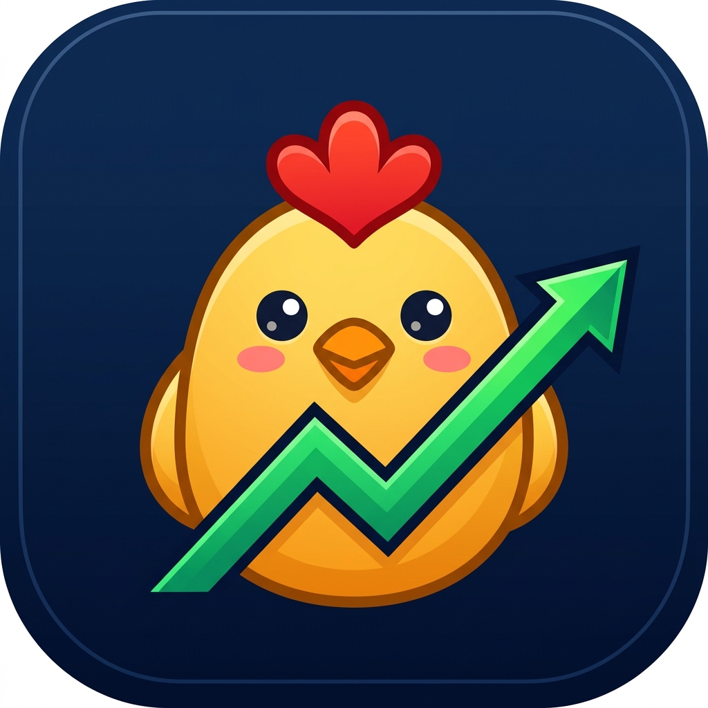
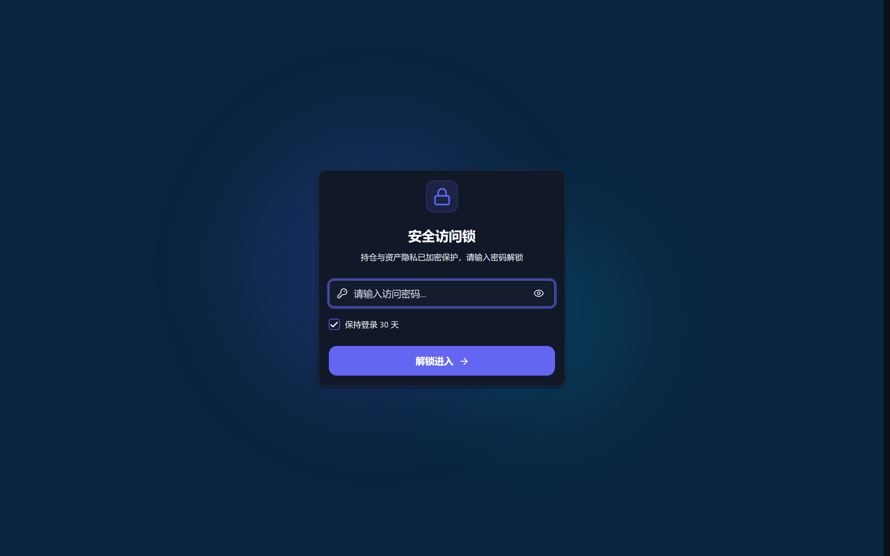
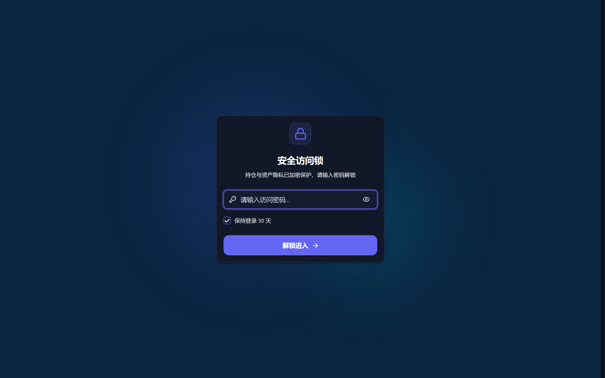
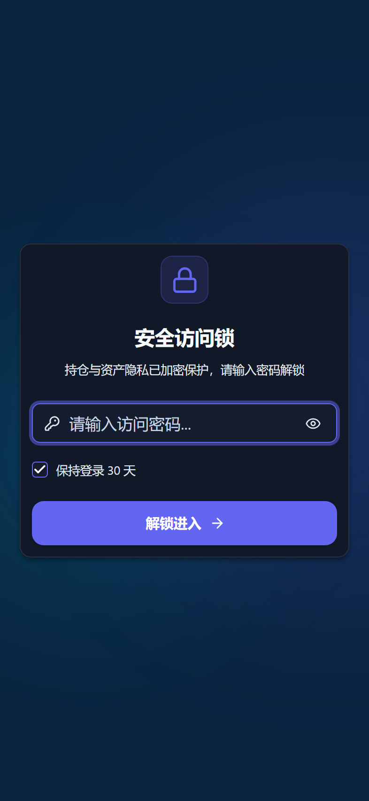

<p align="center">
  <a href="https://github.com/wavesbig/fund-farm">
    
  </a>
</p>

<h1 align="center">养基场 (FundFarm)</h1>

<p align="center">
  <strong>极简、优雅、高颜值的全栈个人基金估值追踪与智能资产管理面板</strong>
</p>

<p align="center">
  <a href="https://github.com/wavesbig/fund-farm/releases"></a>
  <a href="https://github.com/wavesbig/fund-farm/pkgs/container/fund-farm"></a>
  
  
  
  
  <a href="./LICENSE"></a>
</p>

---

## 📖 项目简介

**养基场 (FundFarm)** 是一款专为基民打造的自托管基金估值与持仓看板。基于 **Next.js 16 (App Router)**、**Node 22 原生 SQLite** 与 **Tailwind CSS v4 + shadcn/ui** 全栈打造，采用极致的拟态玻璃（Glassmorphism）与等宽排版设计。

摆脱臃肿与广告，直连金融行情数据源，提供秒级盘中估值、重仓股穿透、板块指数映射联动、AI 截图自动识别持仓，以及私密防窥锁屏保护。

---

## 📸 界面预览

### PC 桌面端 · 全功能资产全景视图
> 玻璃拟态卡片与多列表格切换，实时盘中走势、大盘折叠看板与持仓收益盈亏洞察。

<p align="center">
  
</p>

---

### 系统设置 · 偏好与 AI 大模型配置中心
> 支持深浅主题切换、自选分组管理，支持接入 OpenAI / DeepSeek 等大语言模型进行持仓智能提取。

<p align="center">
  
</p>

---

### 移动端适配 · 流式触控体验
> 针对 iPhone 与主流手机端视口深度打磨，支持滑动操作、触控菜单，打造媲美原生 App 的流畅体验。

<p align="center">
  
</p>

---

## ✨ 核心特性

- ⚡ **实时盘中估值**：输入 6 位基金代码，实时跟踪单位净值、盘中估算净值、估算涨跌幅及分时走势图。
- 🔍 **重仓股穿透追踪**：自动获取前 10 大重仓股票持仓占比，毫秒级追踪重仓股盘中最新行情。
- 🌐 **板块与指数关联**：内置收录 6,000+ 基金与基准指数映射，一键穿透展示对应板块（如纳斯达克100、沪深300等）即时行情。
- 💾 **Node 22 原生 SQLite 持久化**：采用 Node 22 内置 `node:sqlite`（`./data/fund.db`）结合前端 `localStorage` 双轨同步架构，数据毫秒级自动落盘，多端无缝协同。
- 🤖 **AI 截图智能提取**：支持本地 Tesseract.js 离线 OCR，同时原生兼容 OpenAI / DeepSeek / 硅基流动等 LLM 接口，上传支付宝/天天基金持仓截图一键自动导入。
- 🔒 **隐私访问与防窥锁屏**：支持设定独立访问密码与自动/手动锁屏，未授权请求全链路 401 拦截，彻底保障财务隐私。
- 📊 **收益日历与复盘明细**：精确记录持有份额与持仓成本，提供历史收益日历、累计买卖交易流水与定投计划管理。
- 🎨 **现代化 Design System**：基于 Tailwind CSS v4 与 shadcn/ui 组件库全量重构，纯矢量品牌资产，支持 Safari 缩放防抖与暗色模式。

---

## 🐳 Docker 生产部署

### 方式一：直接拉取 GHCR 镜像（强烈推荐，无需源码编译）

官方镜像现已发布至 GitHub Container Registry（GHCR），支持 `linux/amd64` 与 `linux/arm64` 双架构：

```bash
# 1. 创建工作目录
mkdir fund-farm && cd fund-farm

# 2. 下载开箱即用的生产 compose 配置文件
curl -O https://raw.githubusercontent.com/wavesbig/fund-farm/main/docker-compose.prod.yml

# 3. 启动容器服务
docker compose -f docker-compose.prod.yml up -d
```

启动完成后，直接在浏览器中打开 **`http://localhost:3000`** 即可开始使用！数据将自动持久化保存在当前目录下的 `./data` 文件夹内。

---

### 方式二：克隆源码构建部署

如果您希望自定义代码或在本地自行编译：

```bash
# 1. 克隆本仓库
git clone https://github.com/wavesbig/fund-farm.git
cd fund-farm

# 2. 启动构建并运行容器
docker compose up -d --build
```

---

## ⚙️ 环境变量与配置说明

所有配置均提供友好的默认值（可选）。您可以通过在根目录下创建 `.env.local` 传入环境变量，亦可直接在网页端的**系统设置**中随时可视化修改：

| 环境变量 | 类型 | 默认值 | 说明 |
| :--- | :---: | :---: | :--- |
| `APP_PASSWORD` | 可选 | 无 | 强制设定的访问密码（可在未设置密码时作为初始全局密码） |
| `OPENAI_API_KEY` | 可选 | 无 | 大模型 API Key（用于 AI 智能解析持仓截图） |
| `OPENAI_BASE_URL` | 可选 | `https://api.deepseek.com/v1` | 兼容服务商 Base URL（支持 DeepSeek / 硅基流动 / OpenAI 等） |
| `OPENAI_MODEL` | 可选 | `deepseek-chat` | 调用的 LLM 模型标识名称 |
| `NEXT_PUBLIC_GITHUB_LATEST_RELEASE_URL` | 可选 | 官方 Release URL | 用于面板内自动检查 GitHub 最新版本的接口 |

---

## 💻 本地开发

### 环境要求
- **Node.js**：`>= 22.0.0`（需支持内置 `node:sqlite`）
- **npm**：`>= 10.0.0`

### 启动步骤

```bash
# 1. 安装项目依赖
npm install

# 2. 复制环境变量示例文件（可选）
cp env.example .env.local

# 3. 启动 Next.js 极速热重载开发服务器
npm run dev
```

在浏览器打开 `http://localhost:3000` 即可开始开发调试。

### 常用命令

```bash
npm run dev           # 启动本地开发服务
npm run build         # 构建 Next.js 生产产物
npm run start         # 启动 Next.js 生产服务器
npm run type-check    # 执行 TypeScript 静态类型检查
npm run lint          # 执行 ESLint 代码规范检查
npm run release patch # 一键自动化发版（升级版本、构建多架构 Docker 镜像并推送至 GHCR）
```

---

## 📝 免责声明

本项目所有基金与股票金融行情数据均来源于天天基金、东方财富、腾讯财经等公开 API 接口，仅供个人技术研究、数据分析与个人理财学习参考，不构成任何投资建议或交易凭据。

---

## 🙏 致谢 (Acknowledgements)

- 感谢开源项目 [real-time-fund](https://github.com/hzm0321/real-time-fund) 与原作者 [hzm0321](https://github.com/hzm0321) 的早期原型启发。
- 感谢 [shadcn/ui](https://ui.shadcn.com/) 提供的现代化设计系统与优质组件库。

---

## 📄 开源协议 (License)

本项目采用 **[GNU Affero General Public License v3.0](https://www.gnu.org/licenses/agpl-3.0.html)**（AGPL-3.0）开源协议。
完整协议内容参见仓库根目录下的 [LICENSE](./LICENSE) 文件。
